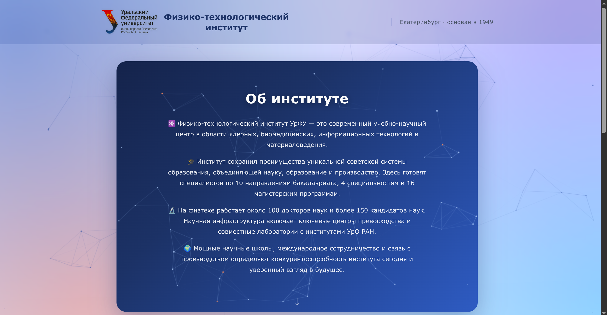

# Сайт кафедр Физико-технологического института (ФТИ) УрФУ

Информационный веб-портал Физико-технологического института УрФУ (г. Екатеринбург). На сайте представлена общая информация об институте, каталог кафедр с указанием заведующих, а также отдельные страницы с подробным описанием каждой кафедры.

## О проекте
- **Главная страница (`index.html`)** — содержит информацию об институте, направлениях подготовки и интерактивный каталог всех кафедр ФТИ.
- **Страницы кафедр (`department.html`)** — динамически отображают подробную информацию о выбранной кафедре.
- **Дизайн** — выполнен в фирменных цветах УрФУ с использованием анимированного фона и карточек с эффектом матового стекла.

## На чем написан сайт
Проект создан без использования сторонних фреймворков на чистом веб-стеке:
- **HTML5** — структура и семантическая разметка страниц.
- **CSS3** — оформление, адаптивная сетка (Flexbox / Grid) и плавные анимации (`style.css`, `department.css`).
- **JavaScript** — отрисовка анимированной сетки на `Canvas` и динамическая подгрузка данных о кафедрах (`departmant.js`).
